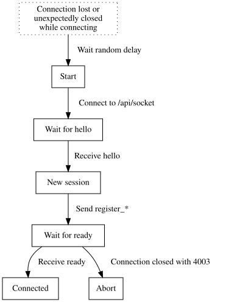
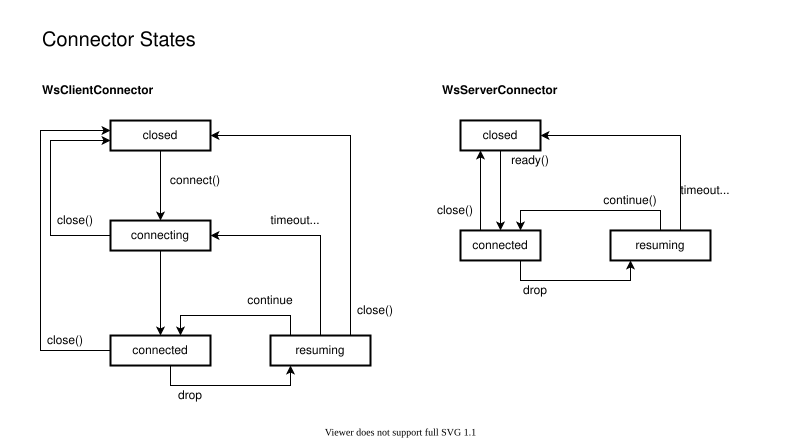
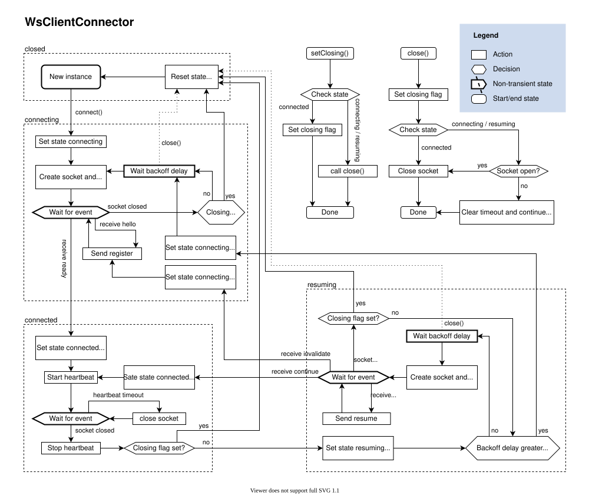
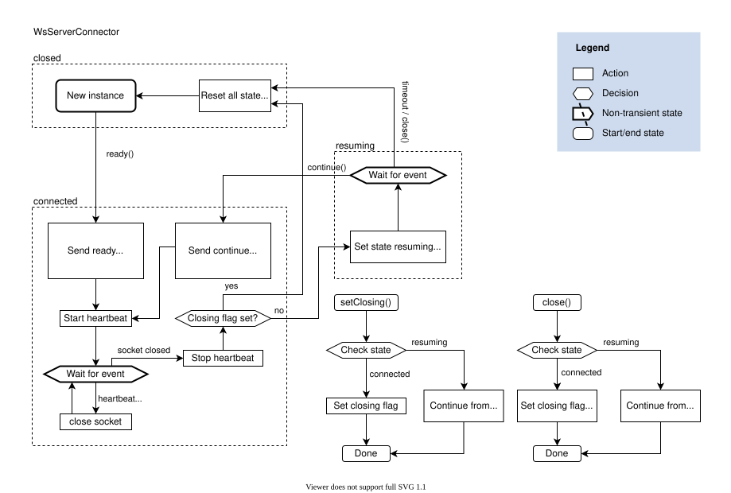

# Protocol

Clusterio communicates using a simple homebrew message passing protocol based on JSON over WebSocket with limited support for reliable transport of messages.
The protocol is implemented in [packages/lib/src/link](/packages/lib/src/link) and uses the `ws` library to handle the WebSocket connections on the Node.js side and the native WebSocket API on the browser side.
The wire schemas are defined in [messages_core.ts](/packages/lib/src/data/messages_core.ts); see the [communication overview](../communication.md) for how links, connectors, and routing fit together.

Two general kinds of messages are supported: events and requests.
Events are messages sent by one party and received by the other and offer no notification for the sender on whether it was actually received.
Requests are pairs of request-response messages where one side sends the requests and the other side replies with a response.
Apart from the handshake used to establish connections the protocol is directionless, and either party can send or receive both requests and events.


## Connection flow

Clients connect via WebSocket to the `/api/socket` endpoint and upon establishing connection to the server the connection is in the handshake phase and the server will send a `hello` message to the client.
If the client has no previous session with the server it sends a `registerHost` or `registerControl` message depending on what kind of client it is to the server.
If the registration is valid, the server responds with a `ready` message containing the client's address, a session token, and session parameters.
The connection has then left the handshake phase; otherwise the server closes it with a WebSocket close code indicating the kind of failure.

Upon leaving the handshake phase both parties should start sending heartbeat messages with the sequence number of the last received message.
Routable messages are stored in a send buffer until a heartbeat acknowledges an equal or higher sequence number, or the session ends.
The heartbeat's top-level `seq` acknowledges receipt by the transport, not successful completion of a message handler.

If the connection goes stale or is unexpectedly closed, the client can re-establish the same session by connecting again and sending a `resume` message after receiving `hello`.
If the session resume is successful then the server will respond with a `continue` message and the connection is active again.
The client then re-sends buffered messages newer than the `lastSeq` in `continue`.
The server likewise re-sends messages newer than the `lastSeq` supplied by the client in `resume`.
Otherwise the server responds with `invalidate`, and the client discards the old send buffer and registers a new session.
Session expiry, buffer overflow, or process failure can lose pending work; plugins must not treat transport recovery as an application-level exactly-once guarantee.
The [send-buffer setting](../configuration.md#controllermax_send_buffer_size) controls how much unacknowledged message data the controller retains for a connection.




## Host pairing

The host id and token sent in `registerHost` come from the installer, which gets them from the controller over HTTP before the host is started.
Hosts are only added to the controller by approving a pairing request, and `registerHost` is rejected with close code 3000 (Unauthorized) for a host id the controller has no record of.
Revoking a host deletes its record, so its token stops working and the installer has to pair it again, which gives it a new id.
See [Setting up remote hosts](/README.md#setting-up-remote-hosts) for how this looks to the user.

The endpoints below take and return JSON bodies and are sent with `Cache-Control: no-store`.
The `POST` endpoints return errors as `{"error": "<message>"}` and respond with 503 while the controller is in recovery mode.
A request body that is not valid JSON or is larger than 4 kB is rejected with 400 or 413 before it reaches the endpoint, without a JSON body.
`GET /api/host-pairing/check` also works in recovery mode, and responds to a token that is not valid with a plain 401 without a JSON body.
A user or host token is sent in either an `Authorization: Bearer <token>` header or an `X-Access-Token` header.

### `POST /api/host-pairing`

Creates a request for a host to join the cluster.

- `name: string` - Name of the host, at most 100 characters after trimming whitespace, without control characters.
- `version: string` (optional) - Version of the installer.

Responds with 202 and `{"requestId": string, "code": string}`.
The `code` is shown to the user to approve the request with, formatted as six characters like `ABC-DEF`.
Codes are matched ignoring case and anything that is not a letter or digit, so `abcdef` matches `ABC-DEF`.
The `requestId` is a secret used to poll for the result, it is never shown to users.

If a user token is sent and the user has the `core.host.approve` permission the host is created right away and the response is 200 with the same body as an approved poll.
An invalid token gives 401 and a user without the permission gives 403, a token is never ignored to create a pending request instead.

A missing or too long name gives 400.
Too many requests from the same address or in total gives 429 with a `Retry-After` header in seconds.

### `POST /api/host-pairing/poll`

- `requestId: string` - Id returned when the request was created.

Responds with 202 and `{"status": "pending"}` while the request is waiting for approval.
Once approved it responds with 200 and `{"hostId": integer, "token": string, "name": string}`, where `name` is the name the host was approved with, which can differ from the one asked for.
Rejected requests give 403, and unknown or expired requests give 404.
The result of an approved or rejected request is only returned once, after which the request is gone.

A pending request expires 30 seconds after it was last polled, and after an hour of waiting.
The installer polls every 2 seconds.

### `POST /api/host-pairing/cancel`

- `requestId: string` - Id returned when the request was created.

Removes a pending request, sent by the installer when it stops waiting.
Responds with 204 whether or not the request existed.

### `GET /api/host-pairing/check`

Checks a host token.
Responds with 200 and `{"valid": true}` if the token is valid and the host it was issued to still exists, and with 401 otherwise.
The installer uses this to tell whether an existing host config still works when it is run again.


## Connector flow

To manage the complexity of connecting, reconnecting, resuming or invalidating dropped sessions the WebSocket connection for a `Link` class is managed by a connector.
There's three kinds of connectors defined: `WebSocketClientConnector`, `WsServerConnector` and `VirtualConnector`.
The virtual connector is for in-memory connections and doesn't have any connection state logic.

For the WebSocket connectors there's four states they can exist in:

- `closed` - The connector has just been created or has been explicitly closed.
- `connecting` (client only) - The connector is in the process of trying to connect to the server.
- `connected` - The connector is successfully connected.
- `resuming` - The connection dropped and the connector is in the process of attempting to resume it.

Along with the following events emitted when transition between states:

- `connect` - A new session is established, moving from `connecting` (client) or `closed` (server) to `connected`.
- `drop` - The transport was lost but the session is retained for resumption, moving from `connected` to `resuming`.
- `resume` - The retained session is reconnected and unacknowledged buffered messages are replayed, moving from `resuming` to `connected`.
- `invalidate` - The previous session cannot be reused, moving from `resuming` to `connecting` (client only); server session expiry emits `close` instead.
- `close` - The connector is closed, moving from any state to `closed`.

Invalidation or closure rejects pending requests with `SessionLost`.
Plugins must handle lost sessions, stale state, and application retries where required; see [connection handling](../writing-plugins.md#handling-connection-events) for the plugin hooks and queueing behavior.




### WsClientConnector

The client connector, named `WebSocketClientConnector` in the source, keeps trying to establish and maintain a connection after `.connect()` is called, stopping on terminal failures such as authentication or policy rejection, or when `.close()`/`.setClosing()` is called.
For example, policy violation (1008) stops retries, while try-again-later (1013), used for send-buffer overflow, permits reconnecting.
Connection retries use exponential backoff.




### WsServerConnector

The [server connector](/packages/controller/src/WsServerConnector.ts) doesn't do the work of connecting or validating the handshake.
Instead it's handed over a WebSocket connection from `WsServer` once there's only the step of sending the final message left to do.
Because of this there's no `connecting` state, and once a session times out from the `resuming` state it goes directly to closed.




## Wire format

All communication uses WebSocket text frames containing a JSON object.
Every frame has a `type` string; the other fields depend on that type.
Requests, responses, and events carry an integer transport sequence number in `seq`, plus source and destination addresses in `src` and `dst`.
Message-specific data is carried in `data` when present.

An address is `[type, id]`, optionally followed by a request ID: `[type, id, requestId]`.
Address types are 0 for controller, 1 for host, 2 for instance, 3 for control, and 4 for broadcast.
The controller's ID is 0; a broadcast address uses its ID to identify the target endpoint type.
For example, `[2, 123]` addresses instance 123, while `[4, 2]` addresses all instances.
Broadcast destinations are for events.

A request puts its request ID in `src`; the response returns that ID in `dst` so the sender can match it to the pending request.
This ID is separate from transport `seq`, which is used for acknowledgements and buffering.


### Handshake Messages

The following messages are used during the handshake phase.
Their listed fields belong inside the frame's `data` object, except for `invalidate`, which has no data.
Property names are case-sensitive.


#### `hello`

Sent by the controller when the WebSocket connection has been opened.

- `version: string` - The version of the controller, e.g. "2.0.0".
- `plugins: Object<string, string>` -
    Object mapping plugin names to plugin version for plugins that are loaded on the controller.

#### `registerHost`

Host handshake for establishing a new connection session.

- `token: string` - Authentication token.
- `version: string` - The protocol version of the host, e.g. "2.0.0".
- `id: integer` - ID of the host.
- `plugins: Object<string, string>` -
    Object mapping plugin names to plugin version for plugins that are available on the host.

The controller closes the connection with code 3000 (Unauthorized) if the token is invalid, was issued for another id, or if there is no host with this id, see [Host pairing](#host-pairing).
If this happens when the host starts it exits with code 8, and the run scripts created by the installer do not restart it.
A host that is revoked while connected is disconnected, is rejected when it tries to connect again, and shuts down.

#### `registerControl`

Control handshake for enstablishing a new connection session.

- `token: string` - Authentication token.
- `version: string` - The protocol version of the control, e.g. "2.0.0".

#### `resume`

Handshake for resuming an existing connection session where the connection had dropped unexpectedly.

- `sessionToken: string` - Session token to resume session with.
- `lastSeq: integer` (optional) - Last transport sequence number received by the client; omitted if none has been received.

#### `invalidate`

Sent by the controller in reply to a resume for a session that cannot be resumed.
The frame is `{"type":"invalidate"}`, without a `data` object.
The client should start a new session with `registerHost` or `registerControl` in response.

#### `continue`

Sent by the controller to signal resuming the session was successful.

- `lastSeq: integer` (optional) - Last transport sequence number received by the server; omitted if none has been received.
- `sessionTimeout: number` - Session timeout in seconds.
- `heartbeatInterval: number` - Interval between heartbeats in seconds.

#### `ready`

Sent by the controller to signal the connection has been established with a new session.

- `src: Address` - The client's address, used as the source of messages it sends.
- `sessionToken: string` - Token to resume the session with.
- `sessionTimeout: number` - Session timeout in seconds.
- `heartbeatInterval: number` - Interval between heartbeats in seconds.
- `account` (optional) - Account details for a control client: a `name` and a `roles` array whose entries contain `name`, `id`, and `permissions`.


### Heartbeat message

Once connected as indicated by the `ready` and `continue` messages both sides of the connection starts sending heartbeats at the inverval given in the `ready` and `continue` messages.
The heartbeat should contain the `seq` of the last received message, and receiving a heartbeat with a given sequence number means that the other party of the link has received all messages up to that seq number.


#### `heartbeat`

Sent by both the controller and clients at the interval given in the continue/ready messages.

- `seq: integer` (optional, top-level) - Last transport sequence number received over the link.

For example, `{"type":"heartbeat","seq":123}` acknowledges messages through sequence 123.
Before receiving any messages, send `{"type":"heartbeat"}`; there is no `data.last_seq` field.

### Events

Events are messages sent in one direction that the receiver acts upon without replying; use [requests](#requests) when a response is needed.
Their wire `type` is `"event"`, with a separate `name` identifying the registered event class.
Plugin names are prefixed, for example `foo_frobber:SomeEvent`.
The `data` payload, when present, contains event-specific properties.

See [packages/lib/src/data/](/packages/lib/src/data/) for core event definitions.
Plugins may define their own events as well.

#### `event`

- `seq: integer` - Transport sequence number.
- `src: Address` - Source address.
- `dst: Address` - Destination address, including broadcast destinations.
- `name: string` - Registered event name.
- `data` (optional) - Payload defined by the event class.


### Requests

Requests expect a response in return.
They function like HTTP requests except that either party of a connection can initiate one.
The wire `type` is `"request"`; a successful reply uses `"response"`, and a failed request uses `"responseError"`.
The request's `name` identifies the registered class, prefixed with the plugin name for plugin messages, such as `foo_frobber:Frobnicate`.

See [packages/lib/src/data/](/packages/lib/src/data/) for core request definitions.
Plugins may define their own requests as well.

#### `request`

- `seq: integer` - Transport sequence number.
- `src: Address` - Source address, including the request ID.
- `dst: Address` - Destination address.
- `name: string` - Registered request name.
- `data` (optional) - Payload defined by the request class.

#### `response` success

- `seq: integer` - This response's transport sequence number, not the request's sequence number.
- `src: Address` - Responding endpoint.
- `dst: Address` - Requester's address, including the original request ID.
- `data` (optional) - Payload defined by the request class's `Response` definition.

#### `responseError`

- `seq: integer` - This error response's transport sequence number.
- `src: Address` - Responding endpoint.
- `dst: Address` - Requester's address, including the original request ID.
- `data.message: string` - Human-readable error description.
- `data.code: string` (optional) - Registered name of the error class, `<plugin>:<class>` for plugin errors.
  Missing or unknown names are received as `InternalServerError`.
- `data.stack: string` (optional) - Error stack.


### Graceful Disconnect

To reduce data loss when closing a link, ask the peer to prepare and wait for it to finish before closing the WebSocket.
Either party can initiate the disconnect and is then responsible for closing the socket.
These are connector control frames, not registered request/response classes; forced closure and process crashes can still lose work.

#### `disconnect` with `data: "prepare"`

The frame `{"type":"disconnect","data":"prepare"}` requests a graceful disconnect.
The receiving party should stop tasks that send events and requests over the link and wait for pending requests it has over the link to complete, but it should not stop responding to requests sent to it.
Only after this process is done should the response be sent.

#### `disconnect` with `data: "ready"`

The frame `{"type":"disconnect","data":"ready"}` signals that preparation is complete and the connection can be closed.
When using `WebSocketBaseConnector.disconnect()`, the initiator must stop producing new work and await its own `Link.prepareDisconnect()` before calling `disconnect()`.
The connector closes as soon as the peer sends `ready` or the timeout expires; it does not drain the initiator's pending requests itself.
There is no error-response variant; the connector also has a timeout so an unresponsive peer cannot block shutdown indefinitely.


### Example handshake

Server hello after opening the WebSocket.

```json
{
    "type": "hello",
    "data": {
        "version": "2.0.0",
        "plugins": {}
    }
}
```

Host registering a new connection session.

```json
{
    "type": "registerHost",
    "data": {
        "token": "xyzabc123",
        "version": "2.0.0",
        "id": 123,
        "plugins": {}
    }
}
```

Controller reply signaling the session is established and ready.

```json
{
    "type": "ready",
    "data": {
        "src": [1, 123],
        "sessionToken": "xyz.azy.bzy",
        "sessionTimeout": 60,
        "heartbeatInterval": 15
    }
}
```

Host and controller can now send events and requests over the connection.
