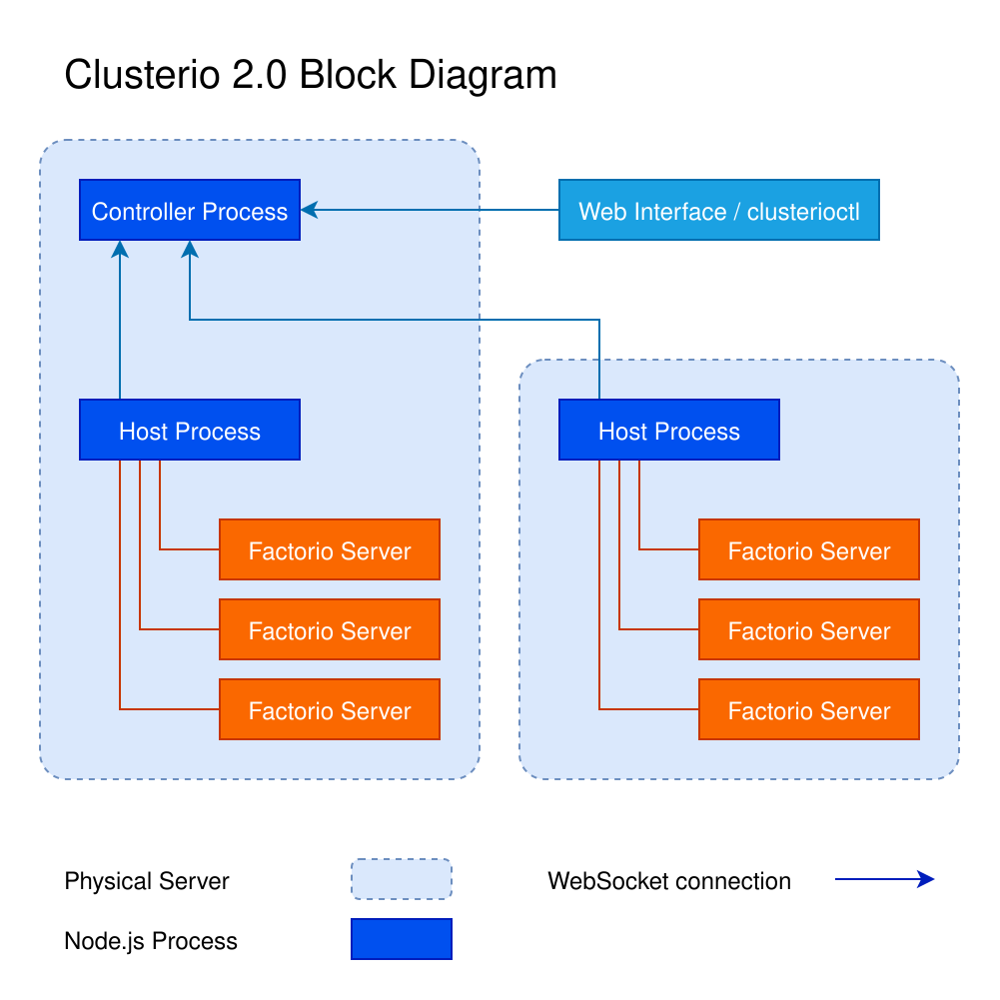

# How Clusterio works

Clusterio runs a group of Factorio servers as a cluster, managed through a web interface or the `clusterioctl` command-line client.
The controller is the central point of contact: clients connect to it to manage the cluster, and hosts connect to it to receive commands and exchange messages.
Each host manages its local Factorio server processes, with each server belonging to an instance.

## System overview

The diagram shows one possible layout with two physical servers, each running a host and three Factorio servers.
The controller shares a machine with one host in this example, but it can run on a separate machine.
The number of hosts and instances can vary with the needs of the cluster.

The blue arrows point from the hosts and clients to the controller they connect to; messages can travel in both directions over those WebSocket connections.
The orange lines connect each host to the Factorio processes it manages.
Open the [full-size diagram](assets/clusterio_2.0_block_diagram.svg) to zoom in, or use the [Draw.io source](assets/clusterio_2.0_block_diagram.drawio) to edit it.

For how messages are handled and routed between these components, see the [communication guide](communication.md).

## Save Patching

In order to efficiently get data in and out of running Factorio servers and to provide custom interfaces Clusterio uses save patching[1] to add code to the game.
The save patching is based on the built in [event_handler](https://github.com/wube/factorio-data/blob/master/core/lualib/event_handler.lua) library to Factorio and requires scenarios to be coded specifically for it.
Mods on the other hand work without modifications.

This can be disabled with the `factorio.enable_save_patching` config on a per instance basis, however disabling it means that modules are not loaded into the game and most plugins will not function.
To use the modules outside of Clusterio the `npx clusteriohost create-scenario` command creates a scenario with the modules patched into it.
Note that the IPC between the game and the host is not available outside of Clusterio, so modules that depend on it will not work as expected in such a scenario.

1: Before version 2.0 of Clusterio this was done at runtime with a patcher called Hotpatch, but due to the difficulty in supporting run time patching and the lack of documentation it was replace it with save patching instead.

## User Accounts

The controller creates and stores accounts for all Factorio users that log into instances under its control.
These accounts are used to store per player data and authorize management of the cluster.
By default users accounts are assigned a Player role that gives a limited read access to the cluster resources, and admins of the cluster can be assigned a Cluster Admin role to get access to manage it.
