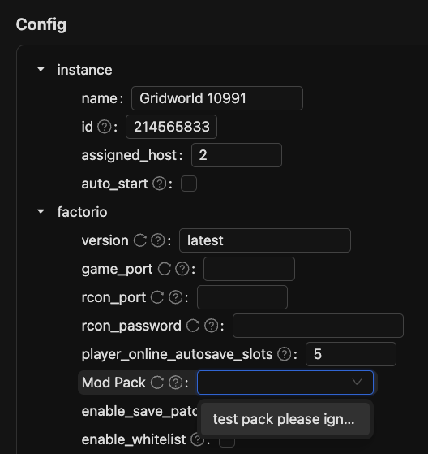
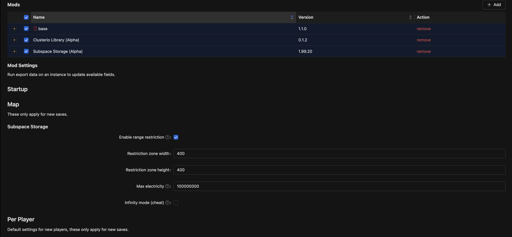
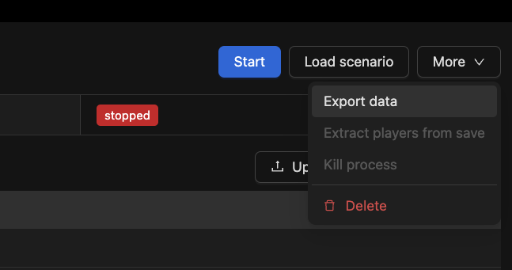

# Managing a Cluster

This guide goes through the day to day tasks of running a cluster from the web interface.
It assumes Clusterio is installed and running, see the [README](/README.md#installation) for how to get there.
Each section ends with the clusterioctl commands for the same task, see [Clusterioctl](clusterioctl.md) for the details of these.

## Logging in

The web interface is hosted by the controller, by default on port 8080.
Log in with an authentication token, the installer prints one for the admin account it creates.
Other users can log in by joining one of the Factorio servers in the cluster if the [Player Auth](/plugins/player_auth/README.md) plugin is installed.
Otherwise a token for a user can be generated on the controller computer with

    npx clusteriocontroller bootstrap generate-user-token <username>

A token gives full access to the account it is for until it is revoked with the Revoke token button on the page of the user.

What a user can see and do in the web interface depends on their roles, see [Users and Permissions](#users-and-permissions).

## Hosts

A host is a computer that runs Factorio servers for the cluster.
See [Setting up remote hosts](/README.md#setting-up-remote-hosts) for how to add one.

The Hosts page lists the hosts with their CPU, memory and disk usage.
The page of a host shows the instances assigned to it, its log and its config.
From there it can be restarted, updated, or removed from the cluster with Revoke host access.

ctl: [Hosts](clusterioctl.md#hosts).

## Instances

An instance is a Factorio server along with its config and saves.
Instances are assigned to a host, which is where the server runs and the saves are stored.

### Creating an instance

Click Create on the Instances page and give the instance a name.
The Host field assigns it to a host straight away, and once a host is picked the Start after creation box starts the instance as soon as it is created.
In this example leave the host unassigned and the box unticked, so the instance can be set up before it starts.
Then open the instance and assign it to a host with the Assign button.

The instance uses the default mod pack set on the Controller page, which is the base game of the newest Factorio version unless changed.
To use a different one pick it under Config -> Factorio -> Mod pack on the instance page, see [Mod Packs](#mod-packs) for setting them up.

ctl: [Create instance](clusterioctl.md#create-instance), [Assign instance to host](clusterioctl.md#assign-instance-to-host).

### Starting and stopping

Click Start on the instance page.
The instance loads the save that was modified last, or creates a new map if it has no saves.
To load a different save, click it in the saves list and use Load save, see [Saves](#saves).
Players connect to the address shown under Public address, or with the Connect via Steam button.
If Factorio credentials are available to the instance and it is set to public, which it is by default, it is also listed in the in-game server browser.
Credentials are taken from the controller, see [Mod Packs](#mod-packs), or set on the host or the instance.

Stop saves the game and shuts the server down.
Restart, in the menu next to Stop, stops the instance and starts it again with the latest save.
Start all and Stop all on the Instances page do the same for every instance, start all skips instances with `instance.exclude_from_start_all` set.

An instance can be started automatically when its host starts with `instance.auto_start`, and restarted after a crash with `instance.restart_after_crash`.

ctl: [Start instance](clusterioctl.md#start-instance), [Stop instance](clusterioctl.md#stop-instance), [Start all instances](clusterioctl.md#start-all-instances).

### Changing settings

The Config section at the bottom of the instance page holds the instance settings.
The server name, description, password, player limit and other options from Factorio's server-settings.json are under Factorio -> Settings.
Most of these, like the name, password and player limit, are applied to a running server right away.
See [Instance Configuration](configuration.md#instance-configuration) for every setting.

To share settings between instances, make one instance into a template with Create template and create the other instances from it.
Instances created from a template take every setting they don't set themselves from it, and follow changes made to the template.

ctl: [Config management](clusterioctl.md#config-management).

### Running commands

The Console section on the instance page shows the log of the instance, and commands typed into it are sent to the Factorio server.
This works like the in-game console with admin rights, so `/c` runs Lua and disables achievements.

ctl: [Send RCON command](clusterioctl.md#send-rcon-command).

## Saves

The saves list on the instance page shows the saves stored on the host for that instance.
Click a save to show the actions for it.
Load save starts the instance with that save, and Download, Rename, Copy and Delete do what they say.
Transfer moves or copies the save to another instance, which can be on a different host.

New saves can be made with Create save, which generates a new map, optionally from a seed or a map exchange string.
Saves can also be uploaded with Upload save or by dropping a save file onto the list.

Several saves can be selected at once with the checkboxes to download, transfer or delete them together.

The `_autosave` saves are written by Factorio.
Loading one starts the instance from a copy of it, so the autosave isn't overwritten.

ctl: [Saves](clusterioctl.md#saves).

## Mod Packs

Mods in Clusterio are managed as parts of mod packs.
A mod pack is a list of mods with their versions, and the mod settings to use with them.
Every instance uses one mod pack, and hosts download the mods in it from the controller when the instance starts.

On the Mods page, use Search to browse the Factorio Mod Portal and download mods to the controller, or upload mod zip files with Upload.
Mod Portal downloads require the controller's [Factorio account credentials](configuration.md#controllerfactorio_username) to be configured.
The username and token are on your profile page on factorio.com, use the token there and not your password.
By default the controller also sends these credentials to the hosts, which put them in the server settings of every instance they start.
This is needed for instances to be listed in the in-game server browser, but it means anyone with access to a host computer can read the token.
Turn off `controller.share_factorio_credentials_with_hosts` if you don't trust the hosts with it.

Use Create in the Mod Packs section to create a mod pack, then add the mods you want to use.
The built in mods of Factorio, like `space-age`, `quality` and `elevated-rails`, are part of every mod pack for a Factorio version that has them.
They can't be removed, but they can be disabled, and only `base` is enabled in a new mod pack.
Assign the mod pack to an instance under Instance config -> Factorio -> Mod pack, or set a default mod pack for new instances on the Controller page.

Mod settings are changed on the page of the mod pack.
The settings only show up after data has been exported for the mod pack, see the next section.

Mod packs can be shared between clusters with Export to string on the mod pack page and Import string on the Mods page.

ctl: [Mods](clusterioctl.md#mods), [Mod Packs](clusterioctl.md#mod-packs).

### Exporting data

The web interface does not know the names and icons of items, or which settings mods have, until they have been exported from Factorio.
Until then items are shown by their internal name without an icon, and the mod pack page has no settings to edit.
This affects every page that shows items, including the plugin pages of Subspace Storage and Player Sync, which use the export of the default mod pack.

To export the data, assign the mod pack to an instance, stop the instance, and click More -> Export data on the instance page.
The export belongs to the mod pack the instance uses, so do this once for each mod pack.
Run it again after adding or updating mods in the pack.

The icons of the base game are read from the Factorio install on the host.
The headless build of Factorio has no graphics, so on a host that only has the headless build the export has the names but none of the base game icons, and the host logs a warning about it.
To get the icons, put a full install of the same Factorio version into the `host.factorio_directory` of the host, or export from a host that has one.
Icons from mods are read from the mod files and are exported either way.

The Icon reference link under Inspect exported data on the mod pack page shows everything in the export.

ctl: [Export data](clusterioctl.md#export-data).

## Users and Permissions

### Players

Clusterio creates a user account for every player that joins an instance.
The Users page lists them with their online time.
The page of a user shows their stats per instance, and has switches for making them an in-game admin, whitelisting them, and banning them.
These lists are shared between all instances that have `factorio.sync_adminlist`, `factorio.sync_whitelist` and `factorio.sync_banlist` turned on, which they are by default.
The whitelist is only enforced on instances with `factorio.enable_whitelist` turned on.

Existing Factorio admin, ban and whitelist files can be imported with Bulk Actions on the Users page, which can also export them.

ctl: [Users](clusterioctl.md#users).

### Granting access to the cluster

Being an in-game admin does not give any access to manage the cluster.
Access to the web interface and clusterioctl is controlled by roles, which are sets of permissions.
There are two roles by default: Cluster Admin, which can do everything, and Player, which can view most of the cluster but not change anything.
New users get the Player role.

To let someone manage part of the cluster, create a role on the Roles page and tick the permissions it should grant.
Every user keeps the Player role, so a new role only needs the permissions on top of it.
For example, a role for starting and stopping servers needs only `core.instance.start` and `core.instance.stop`.
Then add the role to the user under Roles on the page of the user.
Use the Cluster Admin role for people who should have full control.

Be careful with what a role grants, some permissions give much more control than their name suggests.
The Roles page marks the permissions that stop, kill, delete, revoke or update things as dangerous.
For example `core.controller.stop` and `core.host.stop` shut down Clusterio on that computer, and it can only be started again by someone with access to the computer.
`core.user.update_roles` and `core.role.update` are not marked, but they are as powerful as Cluster Admin.
Setting roles has no restrictions, so a user who can do it can give themselves the Cluster Admin role.

The user can then log in as described in [Logging in](#logging-in).

ctl: [Roles](clusterioctl.md#roles), [Set Cluster Roles](clusterioctl.md#set-cluster-roles).

## Plugins and Updates

The Plugins page lists the plugins installed on the controller and each host, with their versions.
If remote updates are enabled, Clusterio and plugins installed from npm can be updated from here, and the Controller and host pages have an Update Clusterio button.
Browse plugins searches npm for plugins, installing them from the web interface needs remote installs to be enabled on the computer.
Installs and updates take effect after a restart, the Plugins page shows which computers are waiting for one.
See [Plugins (Remote)](clusterioctl.md#plugins-remote) for turning remote updates and installs on or off.

Plugins can also be installed on the computer itself, see [Installing Plugins](/README.md#installing-plugins).

## Logs

The Controller page shows the log of the controller, the page of a host the log of that host, and the instance page the log of the instance and its Factorio server.
The log files are stored in the `logs` folder of the controller and are kept for `controller.log_retention_days` days.

ctl: [Logs](clusterioctl.md#logs).
